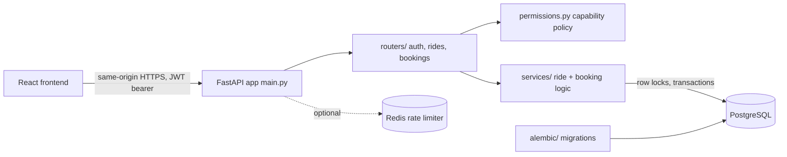

# RideShare API

[](https://github.com/MAAZSHAHEEN/rideshare-api/actions/workflows/ci.yml)
[](LICENSE)

An open-source ride-sharing backend for intercity commuters in Khyber Pakhtunkhwa, Pakistan.
Drivers publish seats on intercity trips, passengers search and request them, and drivers
accept, decline, complete or cancel. Built with FastAPI, async SQLAlchemy and PostgreSQL,
with a React frontend served from the same origin.

**Project status:** early-stage and solo-maintained. Active development happens on the
`rideshare-v2` branch, which is not yet merged into `main`. Contributions and issue
reports are welcome: see [CONTRIBUTING.md](CONTRIBUTING.md).

## Live demo
- App: https://rideshare-api.fastapicloud.dev/
- Interactive API docs: https://rideshare-api.fastapicloud.dev/docs

## Tech Stack
- FastAPI + Pydantic v2
- PostgreSQL + SQLAlchemy 2 (async, asyncpg)
- Alembic (authoritative schema migrations)
- JWT authentication (HS256/384/512, enforced minimum key length)
- Optional Redis-backed authentication rate limiting
- React 19 + Vite + TanStack Query frontend
- Docker, Docker Compose, GitHub Actions CI
- Live demo hosted on FastAPI Cloud

## Architecture



| Path | Responsibility |
|---|---|
| `main.py` | App factory, routers, CORS, frontend serving |
| `config.py` | Environment configuration and startup validation |
| `routers/` | HTTP endpoints for auth, rides and bookings |
| `services/` | Ride and booking business rules, locking and transactions |
| `permissions.py` | Server-side passenger/driver/admin capability policy |
| `models.py`, `schemas.py` | SQLAlchemy models and Pydantic schemas |
| `alembic/` | Database migrations (source of truth for the schema) |
| `auth_rate_limit.py` | Optional Redis-backed login/register throttling |
| `frontend/` | React client (see `frontend/README.md`) |
| `tests/` | PostgreSQL integration test suite (`unittest`) |

## Features
- User registration and login with JWT
- One ordinary account with passenger and driver capabilities; separate admin access
- Driver creates rides
- Passenger books rides
- Driver accepts or rejects bookings
- Database migrations with Alembic

## Dual-mode accounts

A unique email and CNIC still identify one account. Existing `passenger` and
`driver` accounts can both create/manage their own rides and request/manage
bookings on other users' rides. `permissions.py` is the shared server-side
capability policy. Admin accounts have neither ordinary capability and gain no
ownership override. Public registration still rejects admin.

`GET /me` and registration return additive `allowed_modes: ["passenger", "driver"]`
for ordinary accounts, or `[]` for admins. The legacy `role` field and JWT claim
are retained; registration's role selects the initial dashboard, not exclusive
permissions. JWT signature, expiration, subject and database-role matching are
unchanged. There is no mode-switch API or token exchange. A frontend-selected
mode is presentation state, never authorization evidence. Every private operation
still checks the authenticated account and resource ownership on the backend.
Self-booking returns 403 (`You cannot book your own ride`), using the locked,
refreshed Ride row before inserting a booking.

This is a policy transition, not a data migration: no users, role values, IDs,
foreign keys, histories, indexes or constraints are rewritten. Alembic head stays
`d924a6e38f10`. Existing tokens remain valid until their normal expiration.
The existing uniqueness constraints continue to prevent duplicate email/CNIC.
Roll out the backend before the new frontend, which requires `allowed_modes`
from the verified profile. Older clients can continue reading `role` but must
adopt capabilities to expose both dashboards.

No driver verification is claimed or simulated. If verification becomes required,
add persisted eligibility with an explicit migration/onboarding policy and enforce
it in the shared server capability policy and profile response. Do not encode a
selected dashboard into JWTs to grant driver permissions. Resource ownership,
Ride -> Booking locks, booking ID lock ordering, transactions and seats are
unchanged by switching views.

## API Endpoints

### Auth
- POST /auth/register — register new user
- POST /auth/login — login and get JWT token

### Rides
- POST /rides/ — create ride (driver capability, ordinary accounts)
- GET /rides/ — search rides by origin and destination

Ride creation requires a timezone-aware departure strictly in the future (for
example, an ISO 8601 timestamp with `Z` or `+05:00`). Naive or already-departed
timestamps return 422. Times are compared in UTC.

`GET /rides/` requires authentication and returns a JSON list for all roles.
Only active rides with sufficient seats and departure strictly after the
request's current UTC time are searchable. Completed, cancelled, sold-out,
and departed rides are excluded; there is no status override.

Optional query parameters:

- `origin`, `destination`: exact, case-sensitive matches; either or both may
  be omitted. Empty strings are invalid. Whitespace is not trimmed.
- `departure_from`: inclusive lower departure bound.
- `departure_before`: exclusive upper departure bound. Both time bounds require
  a timezone offset; when supplied together, the lower must precede the upper.
  Use midnight-to-midnight bounds to search a calendar day in a chosen timezone.
  A past lower bound never includes already-departed rides.
- `min_seats`: minimum available seats, default 1, range 1 through 2147483647.
- `limit`: default 20, range 1 through 100.
- `offset`: default 0, range 0 through 9223372036854775807.

Invalid query values return 422. SQL applies filters before pagination and orders
by `departure_time ASC, id ASC`. The response remains a list without a total count.
Existing callers passing both locations still work, but now receive bounded,
future-only results. Offset pages can shift as rides are added or changed.

Revision `b83d12f7a906` adds `ix_rides_status_departure_time_id` on
`(status, departure_time, id)` for the shared active/future/ordered query path.
Apply it with `alembic upgrade head`. This ordinary transactional index build
can block writes while it runs; schedule it appropriately for populated databases.

`PATCH /rides/{ride_id}/cancel` lets only the owning driver transition an active
ride to cancelled. It returns the existing ride JSON (200). Missing rides return
404, completed/already-cancelled rides return 409, and non-owners or admins
receive 403.

The transaction locks the Ride first, then its pending/accepted bookings ordered
by booking ID. Those bookings become cancelled; rejected/cancelled history is
preserved. Each accepted booking cancelled restores one previously consumed seat,
matching passenger cancellation. Pending bookings restore none. This reverses
known debits without reconstructing original capacity; the count on a cancelled
ride is bookkeeping, not usable capacity. The ride, bookings, and seat adjustments
commit together. A cancelled ride has no pending/accepted bookings and cannot
receive new bookings. Concurrent booking actions serialize on the same Ride lock.

`PATCH /rides/{ride_id}/complete` lets only the owning driver transition an active
ride to completed and returns the existing ride JSON (200). Missing rides return
404; completed/cancelled rides return 409; non-owners and admins receive 403. There is no reopening or automatic time-based completion.

Completion locks and refreshes the Ride, then locks pending bookings in ID order.
Pending requests become cancelled, while accepted/rejected/cancelled history is
preserved. Seats never change during completion: accepted places remain consumed
as historical accounting. All transitions commit atomically with rollback on
failure. Completed rides have zero pending bookings. Completion and cancellation
serialize on the Ride lock, so exactly one terminal ride transition can win.

### Bookings
- POST /bookings/{ride_id} — book a ride (passenger capability, ordinary accounts)
- PATCH /bookings/{booking_id}/respond — accept or reject booking (driver capability, ordinary accounts)

`PATCH /bookings/{booking_id}/cancel` lets only the owning passenger cancel a
pending or accepted booking on an active ride. It returns the existing booking
JSON with status `cancelled` (200). A pending cancellation does not change seats; an accepted
cancellation restores exactly one seat in the same transaction. Rejected or
already-cancelled bookings return 409, another account or an admin
receives 403, and a missing booking returns 404.

Cancellation and driver decisions serialize using PostgreSQL row locks in
Ride -> Booking order. If acceptance wins first, acceptance and cancellation
may both succeed with no net seat change. Cancelled history remains stored and
does not prevent a new booking under the existing active-booking unique index.
Passenger cancellation on completed/cancelled rides returns 409. In particular,
accepted bookings on completed rides cannot be cancelled or restore seats. If
passenger cancellation wins the Ride lock before completion, its cancellation
and any valid seat restoration persist; completion may then also succeed.
No departure-time cutoff is imposed by this endpoint.

API errors use FastAPI's existing `{"detail": ...}` response. Authentication
failures return 401 with `WWW-Authenticate: Bearer`; login uses the same generic
message for unknown accounts and incorrect passwords. Permission/ownership
failures return 403 and missing resources return 404.

State conflicts return 409, including inactive rides, unavailable seats,
duplicate active bookings, invalid lifecycle transitions, and duplicate
registration details. Registration conflicts use a generic message without
identifying the conflicting field. FastAPI/Pydantic body and query validation
returns 422 with an error list; existing departure/time-window checks return
422 with a string detail. Successful response shapes are unchanged.

Only the recognized duplicate-active-booking database constraint is translated
to 409; unrelated database failures propagate normally. The `/test-db` diagnostic
returns a generic 503 on connection failure without exposing exception text.

## Frontend read endpoints

All endpoints below require a bearer token. `GET /me` returns the typed
`UserResponse` (id, name, email, role, allowed_modes); it does not return CNIC or phone number.

- `GET /rides/{ride_id}`: any authenticated role can read the existing ride
  response, including departed, sold-out, completed and cancelled rides. Missing
  rides return 404.
- `GET /rides/me`: ordinary accounts in their driver capacity; returns only their own rides, with optional
  `status=active|completed|cancelled`, ordered by departure time DESC, id DESC.
- `GET /bookings/me`: ordinary accounts in their passenger capacity; returns only their bookings, each with
  a nested `ride` containing the existing ride response fields.
- `GET /rides/{ride_id}/bookings`: owning driver only; each booking includes
  `passenger: {id, name}`. No passenger email, CNIC, phone or password is returned.
  Non-owners/admin accounts receive 403; an eligible account lookup of a missing
  ride receives 404.

Both booking lists order by booking id DESC and accept optional
`status=pending|accepted|rejected|cancelled`. All three collections include history
by default and return plain lists with `limit` (default 20, range 1–100) and
`offset` (default 0, range 0–9223372036854775807). Filters apply before pagination;
invalid values return 422. These reads do not change lifecycle rules or seats.

Set `FRONTEND_ORIGINS` to a comma-separated list of exact HTTP(S) frontend origins,
for example `http://localhost:5173,http://127.0.0.1:5173` in development. Configure
the deployed frontend origin explicitly in production. No paths, trailing slashes,
credentials or wildcards are accepted. The default empty list disables cross-origin
browser access. CORS allows GET/POST/PATCH with Authorization and Content-Type
headers, without cookie credentials. CORS is not a replacement for authentication.

## Ride and booking service responsibilities

`routers/bookings.py` declares the HTTP routes, dependencies, and response models.
`services/bookings.py` implements booking creation, driver decisions, and passenger
cancellation using the request's existing `AsyncSession`. It contains the business
rules, queries, Ride -> Booking locks, seat accounting, commits, and existing
rollback/error behavior. Services retain the existing `HTTPException` contract;
`routers/rides.py` likewise keeps route declarations, authentication dependencies,
query validation, and response models. `services/rides.py` implements creation,
search, cancellation, and completion with the same explicit session ownership,
Ride -> Booking(s) lock order, and existing transaction/error behavior.

## Full-stack packaging

The production build can serve React and the existing API from one HTTPS origin.
See [DEPLOYMENT.md](DEPLOYMENT.md) for the multi-stage Docker build, FastAPI Cloud's
prebuilt-frontend upload requirements, local validation and rollback procedure.
No deployment or production configuration changes are automated by this task.

## Local Setup

Requirements: Python 3.11+, PostgreSQL 15+ (or Docker), and optionally Node 22.12+ for the frontend.

```sh
git clone https://github.com/MAAZSHAHEEN/rideshare-api.git
cd rideshare-api
python -m venv venv
source venv/bin/activate        # Windows: venv\Scripts\activate
pip install -r requirements.txt
cp .env.example .env            # then edit the values
```

`SECRET_KEY` must be a random value of at least 32 bytes for HS256; placeholder values are
rejected at startup. One way to generate one:

```sh
python -c "import secrets; print(secrets.token_urlsafe(48))"
```

Start PostgreSQL (Docker Compose exposes it on `localhost:5433`), apply migrations and run the API:

```sh
docker compose up -d db
alembic upgrade head
uvicorn main:app --reload
```

Open http://127.0.0.1:8000/docs for the interactive API docs.

## CI and testing

GitHub Actions runs one Python 3.11 job on pull requests and pushes to `main`
and `rideshare-v2`. It uses a fresh PostgreSQL 15 service with a readiness health
check, installs `requirements.txt`, validates configuration, applies Alembic from
scratch, and runs the complete PostgreSQL unittest suite. Concurrency and
migration upgrade/downgrade/re-upgrade tests are included. No developer `.env`
or repository secrets are required; workflow credentials are disposable CI-only
values. The GitHub token has read-only contents permission. This workflow does
not deploy or publish images.

To run the same commands locally, first provision a disposable PostgreSQL database
whose user can create schemas and databases (`CREATEDB`). Set `DATABASE_URL` and
`TEST_DATABASE_URL` to its `postgresql+asyncpg` connection URL, set a non-placeholder
`SECRET_KEY` of at least 32 UTF-8 bytes, and set `ALGORITHM=HS256` and
`ACCESS_TOKEN_EXPIRE_MINUTES=60` in the process environment. Never use a production
database for these commands. From the repository root, with Python 3.11 activated:

```sh
python -m pip install -r requirements.txt
python -m pip check
python -m alembic upgrade head
python -B -m unittest discover -s tests -v
```

`TEST_DATABASE_URL` must be set: integration tests otherwise skip. API tests
isolate their fixtures in temporary schemas; migration tests create and remove
their own disposable databases. The initial Alembic command migrates the database
named by `DATABASE_URL`.

## Database Migrations

Alembic owns the application schema. Run `alembic upgrade head` before starting
the API against a new database. Application startup checks database connectivity
but never creates or updates tables.

The pre-production initial revision `50872040220b` now creates the current
schema. It previously contained no schema operations. A database already stamped
at that revision will not rerun it. Existing databases created by the old startup
behavior must be inspected and reconciled separately; do not blindly stamp or
reapply the initial migration over existing tables. Recreate only disposable
development databases. Do not downgrade a database containing data you need.

After changing models, always run:
   alembic revision --autogenerate -m "describe your change"
   alembic upgrade head

Review generated migrations before applying them. The PostgreSQL migration test
verifies empty-database upgrade, metadata parity, downgrade to base, and a second
upgrade. Set `TEST_DATABASE_URL` to a dedicated PostgreSQL test database and run
`python -B -m unittest discover -s tests -v`. The migration test additionally
requires `CREATEDB` permission: it creates and removes its own disposable database
on that test server, without modifying the configured database's application data.

## Authentication rate limiting (disabled pending proxy verification)

Authentication throttling is opt-in through `AUTH_RATE_LIMIT_ENABLED=true`.
It is **not activated for FastAPI Cloud**: first verify the platform's ingress
header sanitization, origin isolation, and Uvicorn trusted-proxy configuration.
Only then set `AUTH_RATE_LIMIT_CLIENT_IP_SOURCE=verified-asgi`. This setting is
an operator acknowledgment, not automatic verification. The application uses
only the ASGI client address and never reads forwarding headers. A misconfigured
server could group all users behind one proxy or accept spoofed identities.

Set `AUTH_RATE_LIMIT_REDIS_URL` to TLS Redis (`rediss://`), and
`AUTH_RATE_LIMIT_HMAC_KEY` to a separate random secret of at least 32 bytes.
Plain Redis is allowed only on loopback for disposable development/tests.
All replicas must share the Redis database, namespace, HMAC key, and limits.
Changing a namespace/key resets allowances. Do not log URLs or limiter identifiers.

The defaults are first-attempt fixed windows: 30 login requests per IP per
60 seconds, 5 registration requests per IP per 600 seconds, and 5 login attempts
per normalized IP/email pair per 60 seconds. Environment settings in `.env.example`
configure these separately. Coarse gates run before body validation, so malformed
requests count. The login pair gate runs before SQL and bcrypt. All attempts count,
including successful ones; there are no permanent account lockouts.

Redis Lua performs each counter/expiry decision atomically. Denied requests do
not extend the window. HTTP 429 includes `Retry-After` and `Cache-Control: no-store`.
Enabled enforcement fails closed with generic HTTP 503 if Redis or the client
identity is unavailable; other routes remain unaffected. Calls have bounded
timeouts and no automatic retries. Sensitive identifiers are keyed HMAC digests,
not raw IPs or emails. CORS remains outside the gate.

Fixed windows allow bursts across window boundaries. Shared networks can share
quotas, distributed attackers can change IPs, and Redis eviction/failover can
reset counters. Use adequate capacity and a suitable eviction policy; this is
abuse throttling, not a durable quota ledger. Free-tier exhaustion/outages can
prevent login while enforcement is enabled. No services are provisioned here.

For tests, use disposable loopback PostgreSQL (`TEST_DATABASE_URL`) and Redis
(`TEST_REDIS_URL`, for example `redis://127.0.0.1:6379/0`). Keep
`AUTH_RATE_LIMIT_ENABLED=false` for the original regression suite; new integration
tests explicitly enable isolated limiter instances and unique key namespaces.
Run `python -B -m unittest discover -s tests -v`. CI supplies both services.
Never supply production service URLs. The tests clean only their own namespaces.

## Contributing

Bug reports, documentation fixes and pull requests are welcome. Read
[CONTRIBUTING.md](CONTRIBUTING.md) for setup, test and pull request guidelines.

## Security

Please do not report vulnerabilities in public issues. See [SECURITY.md](SECURITY.md).

## License

Released under the [MIT License](LICENSE). Copyright (c) 2026 Maaz Shaheen.
